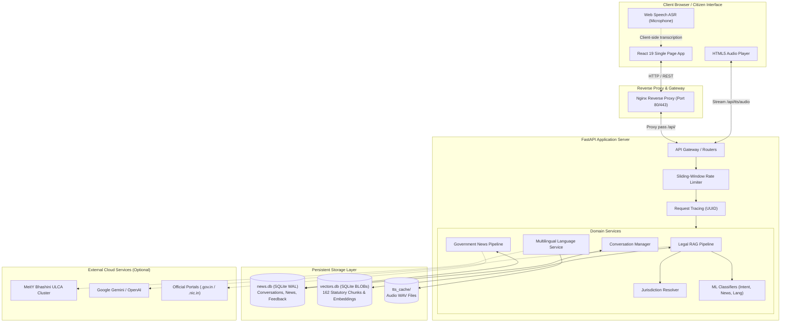
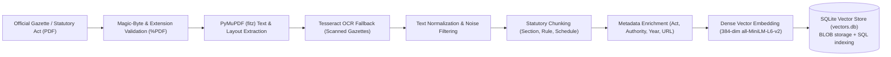
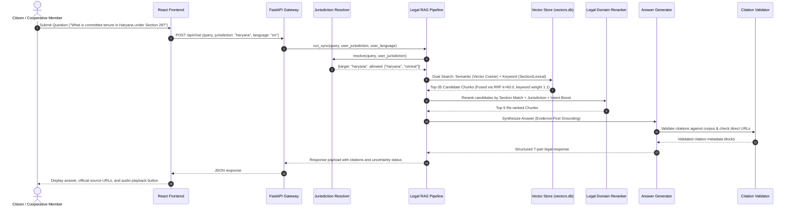
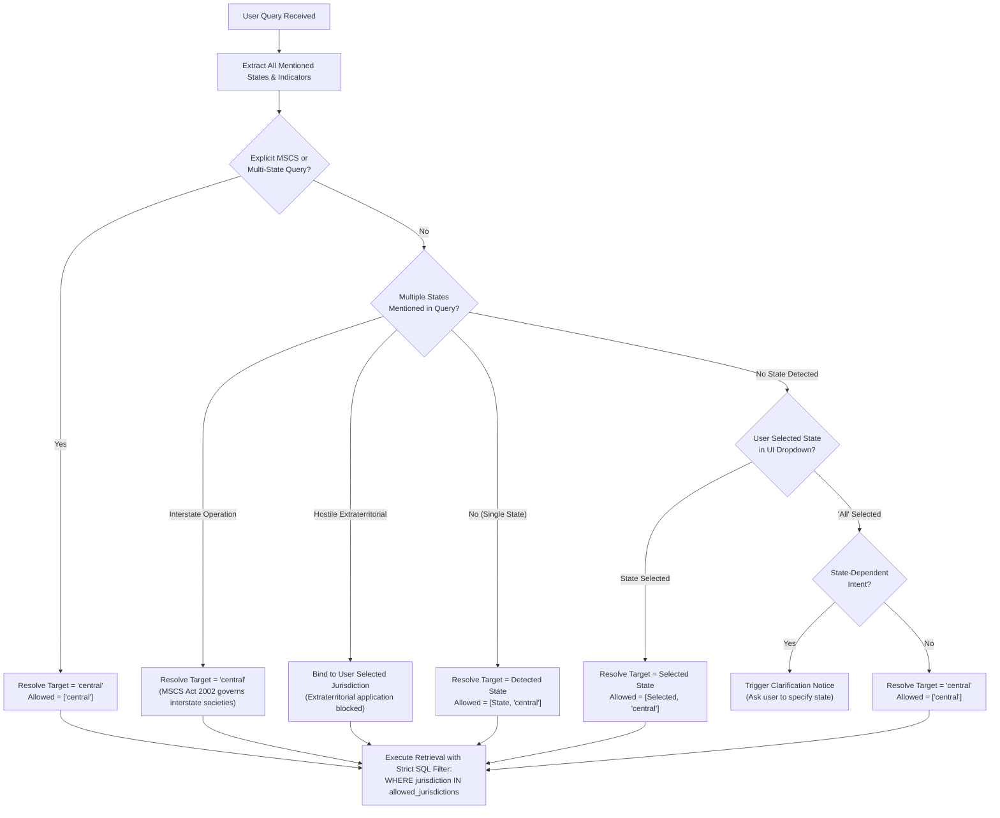
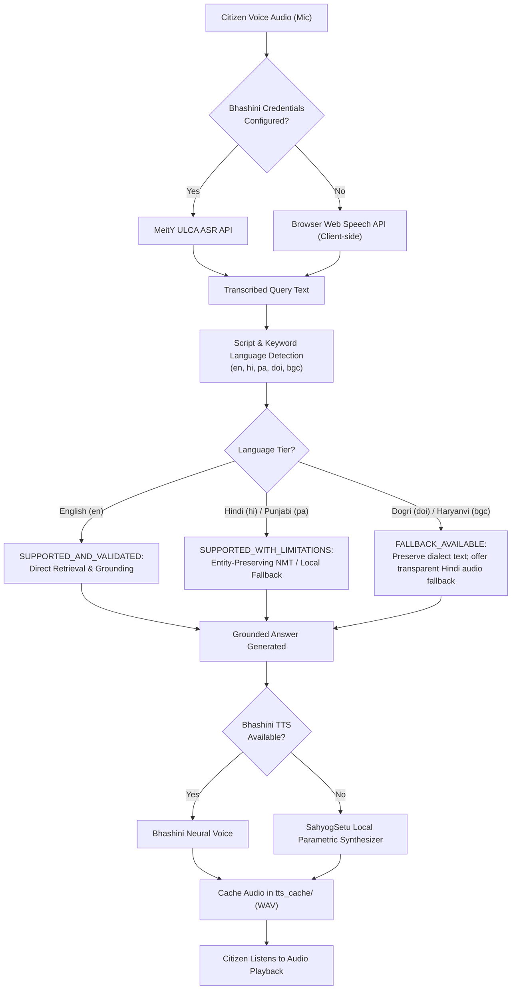
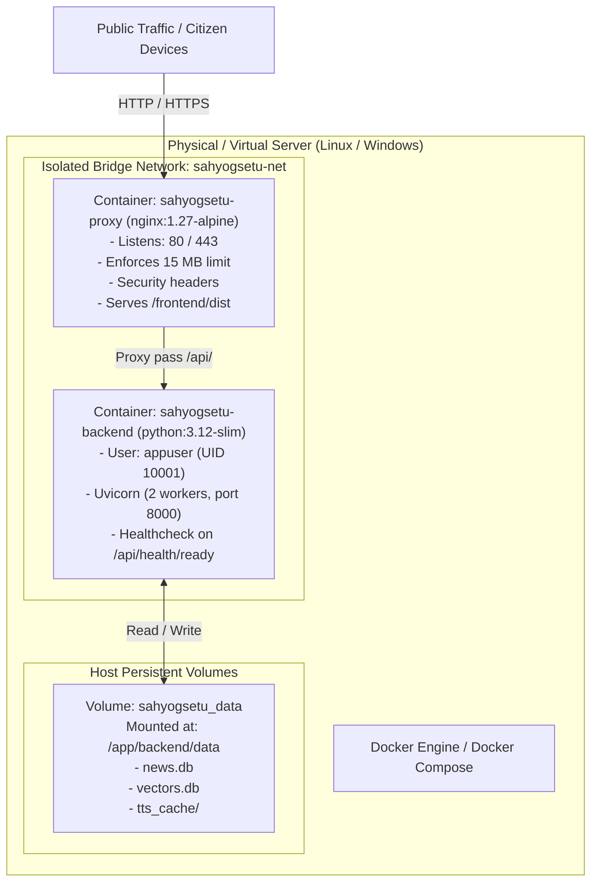

# SahyogSetu — Final System Architecture Documentation

**Document Version:** 2.1.0  
**Date:** November 2026 (Phase 13 Remediation) (Phase 13 Remediation)  
**Project:** SahyogSetu — Multilingual Cooperative Governance & Legal Assistance System  
**Audience:** System Architects, Academic Evaluators, Senior Software Engineers, and Operations Teams  

---

## 1. System Overview

SahyogSetu is a domain-specific, source-grounded multilingual legal information system and conversational assistant designed for Indian primary cooperative societies (PACS), state cooperative departments, dairy/fishery cooperatives, and farming communities.

Unlike open-domain conversational models that speculate or produce hallucinated statutory interpretations, SahyogSetu enforces a **strict evidence-first Retrieval-Augmented Generation (RAG) architecture**. Every emitted legal interpretation or compliance procedure is explicitly tethered to verified statutory gazettes, parliamentary acts, departmental notifications, or scheme master circulars across four defined jurisdictions:
1. **Central Jurisdiction:** Multi-State Co-operative Societies Act 2002 (amended 2023), Model Byelaws for PACS, RBI Kisan Credit Card (KCC) Master Circulars, and PMFBY Guidelines.
2. **Punjab Jurisdiction:** Punjab Cooperative Societies Act 1961 (amended through 2021), PADB One-Time Settlement (OTS) Guidelines, and Cooperative Department Circulars.
3. **Haryana Jurisdiction:** Haryana Co-operative Societies Act 1984.
4. **Jammu & Kashmir Jurisdiction:** Jammu & Kashmir Cooperative Societies Act 1989.

---

## 2. Architectural Layers

SahyogSetu is structured into decoupled, modular architectural layers:

```
+---------------------------------------------------------------------------------------+
|                                1. PRESENTATION LAYER                                  |
|  React 19 SPA | TypeScript | Vite | Tailwind CSS | Lucide Icons | Web Speech ASR/TTS   |
+---------------------------------------------------------------------------------------+
                                           | HTTP / REST (JSON)
+---------------------------------------------------------------------------------------+
|                                  2. REVERSE PROXY                                     |
|  Nginx 1.27 | TLS Termination | Security Headers | Rate Limiting | 15 MB Body Ceiling |
+---------------------------------------------------------------------------------------+
                                           | Reverse Proxy (Port 8000)
+---------------------------------------------------------------------------------------+
|                                  3. API GATEWAY                                       |
|  FastAPI ASGI | Request Tracing Middleware | Sliding Window Rate Limiting | CORS      |
+---------------------------------------------------------------------------------------+
                                           |
+---------------------------------------------------------------------------------------+
|                                 4. APPLICATION SERVICES                               |
|  - RAG Retrieval & Orchestration       - Language & Translation (Bhashini / Fallback)|
|  - Jurisdiction Resolver & Guardrails   - Voice Recognition & TTS Manager             |
|  - Machine Learning Inference          - Document Intelligence & PDF Parser           |
|  - Government News Ingestion Engine    - Conversation & Feedback Manager              |
+---------------------------------------------------------------------------------------+
                     |                                       |
+-------------------------------------+   +---------------------------------------------+
|        5. VECTOR DATA LAYER         |   |          6. RELATIONAL DATA LAYER           |
|  SQLite Vector Store (vectors.db)   |   |  SQLite 3 WAL Mode (news.db)                |
|  - 384-dim Dense Embeddings (BLOBs) |   |  - News items & verified sources            |
|  - Statutory Document Chunks (162)  |   |  - Conversation sessions & message history  |
|  - Exact Lexical & Metadata Indexes |   |  - Citizen feedback & audit telemetry       |
+-------------------------------------+   +---------------------------------------------+
```

### Detailed Layer Specifications:
1. **Presentation Layer (Frontend):**
   - Single-Page Application (SPA) built with React 19, TypeScript, and Vite.
   - Core interfaces: Chat interface with markdown parsing, jurisdiction dropdown (Central, Punjab, Haryana, J&K), language selector (English, Hindi, Punjabi, Dogri, Haryanvi), citation drawer, document upload modal, and government news dashboard.
   - Client-side audio handling: Browser Web Speech API for voice input; HTML5 Audio streaming for neural and harmonic TTS output.
2. **Reverse Proxy Layer (Nginx):**
   - Hardened Alpine Nginx instance acting as reverse proxy and static asset server.
   - Injects security headers (`X-Frame-Options: SAMEORIGIN`, `X-Content-Type-Options: nosniff`, `Content-Security-Policy`, `Permissions-Policy`).
   - Limits client request payloads to 15 MB to match application boundaries.
   - Forwards client IP headers (`X-Real-IP`, `X-Forwarded-For`, `X-Forwarded-Proto`).
3. **API Gateway Layer (FastAPI):**
   - Asynchronous Python REST API running under Uvicorn ASGI server.
   - Request tracing middleware attaches unique UUID correlation IDs to every request.
   - Sliding-window rate limiter prevents API abuse (30 requests/minute per IP with `Retry-After: 60s`).
   - Global exception handlers catch domain exceptions (`EntityNotFoundException`, `ValidationException`, `FileTooLargeException`) and return safe structured error envelopes.
4. **Application Services Layer:**
   - **Legal RAG Pipeline:** 15-stage retrieval and answer generation pipeline.
   - **Jurisdiction Resolver:** Multi-state detection, extraterritorial application blocking, and clarification trigger engine.
   - **Language Services:** Transparent router supporting Bhashini ULCA cloud endpoints when configured, with offline fallback synthesizers and Web Speech.
   - **ML Inference Engines:** Scikit-learn TF-IDF + LinearSVC/LogisticRegression models for intent classification, news relevance, and language identification.
   - **News Ingestion Engine:** Periodic collector with SSRF-protected HTTP fetching, official source verification, and duplicate detection.
5. **Data Layers:**
   - **Relational Store (`news.db`):** SQLite 3 with Write-Ahead Logging (`PRAGMA journal_mode=WAL;`) and strict foreign key integrity (`PRAGMA foreign_keys=ON;`). Stores news items, news sources, conversations, messages, feedback ratings, and document uploads.
   - **Vector Store (`vectors.db`):** Stores 162 canonical statutory chunks across 11 indexed Acts and Schemes (Central: 24, Punjab: 51, Haryana: 26, J&K: 26, plus schemes) with 384-dimensional dense embeddings stored as binary BLOBs alongside complete 24-field structured statutory metadata (doc_id, section, rule, jurisdiction, page, source_url).

---

## 3. Architectural Diagrams

### 3.1 High-Level System Architecture



---

### 3.2 Legal Document Ingestion Pipeline



---

### 3.3 Legal RAG Query & Answer Generation Pipeline



---

### 3.4 Jurisdiction-Aware Retrieval & Territorial Boundary Flow



---

### 3.5 Multilingual Query & Speech Services Flow



---

### 3.6 Government News Aggregation & Verification Pipeline

```mermaid
flowchart LR
    Sources["19 Official Government Portals\n(PIB, Cooperation.gov.in, State Gazettes)"] --> SSRF["SSRF & Domain Whitelist Validator\n(Reject 127.0.0.1, metadata, private IPs)"]
    SSRF --> Fetch["Async HTTP Collector (with timeout & retry)"]
    Fetch --> Parse["HTML / RSS / PDF Parser (BeautifulSoup4, Feedparser)"]
    Parse --> Dedupe["Deduplication Engine (URL + Headline Hash)"]
    Dedupe --> Classify["ML News Sector Classifier (TF-IDF + LinearSVC)"]
    Classify --> Verify["Official Source Verifier\n(Direct Document URL Check)"]
    Verify --> StoreDB[("news.db (SQLite)\nPreserve direct document link")]
    StoreDB --> Feed["Faceted News Feed API (/api/news)\nFilter by State, Category, Document Type"]
```



---

### 3.7 Deployment Architecture



---

## 4. End-to-End Citizen Query Data Flow

1. **Submission:**
   The citizen enters a natural language query via the chat input or microphone. The interface sends an HTTP `POST /api/chat` with:
   - `query`: Text string (sanitized against prompt injection delimiters).
   - `jurisdiction`: Selected UI dropdown (`all`, `central`, `punjab`, `haryana`, `jk`).
   - `language`: Selected interface language (`en`, `hi`, `pa`, `doi`, `bgc`).
   - `conversation_id`: UUID for thread persistence.

2. **Language Normalization:**
   The language detector determines the script (Latin, Devanagari, Gurmukhi). If Hindi or Punjabi, entity-preserving translation normalizes the query for retrieval while safeguarding statutory terms (e.g., section numbers, Act names).

3. **Jurisdiction Determination & Hierarchy Enforcement:**
   `JurisdictionResolver` inspects the query text and dropdown selection:
   - If multiple states are mentioned in an adversarial context (e.g. applying Punjab law in Haryana), it binds the query to the local society jurisdiction (Haryana) and restricts allowed retrieval to `["haryana", "central"]`, completely blocking Punjab statutes.
   - If the query concerns multi-state operations, it assigns `central` (Central MSCS Act 2002).
   - If the query asks a state-dependent question (e.g. committee tenure) without specifying a state and with `all` selected, it returns a **Jurisdiction Clarification Prompt**.

4. **Dual Retrieval & Reciprocal Rank Fusion (RRF):**
   - **Semantic Search:** Dense 384-dimensional embedding generated via `all-MiniLM-L6-v2` and compared via cosine similarity against vectors in `vectors.db`.
   - **Keyword Search:** Exact statutory token, section number, and BM25 token matching in SQLite.
   - **RRF Fusion:** Merges the candidate lists with reciprocal rank scoring ($k=60$).

5. **Legal Domain Reranking:**
   Reranks top candidates using domain-specific boost heuristics:
   - $+0.35$ for exact section match.
   - $+0.20$ for primary jurisdiction alignment.
   - $+0.15$ for query token overlap.
   - $+0.10$ for intent category match.

6. **Evidence Gating & Abstention:**
   If a specific section was queried and no matching section exists in the retrieved chunks, or if the top reranking score is below $0.28$, the system triggers the **No-Evidence Abstention** mechanism. It outputs a truthful notice stating that sufficient authoritative evidence was not found, preventing hallucinations.

7. **Grounded Answer Generation & Citation Validation:**
   - The structured statutory synthesizer constructs a 7-part legal answer (Direct Answer, Plain Explanation, Statutory Provision Details, Important Conditions, Disclaimer, and Source References).
   - `CitationValidator` cross-references every cited source against the retrieved chunks, verifying document titles, page numbers, and official government URLs (`.pdf` or `.gov.in` portal links).

8. **Multilingual Rendering & Audio Synthesis:**
   - The answer is rendered in the citizen's target language.
   - For Dogri and Haryanvi, text is displayed in the vernacular with an explicit, honest disclosure offering a standard Hindi audio alternative.
   - Audio is synthesized, cached in `tts_cache/`, and returned with audio streaming links.
